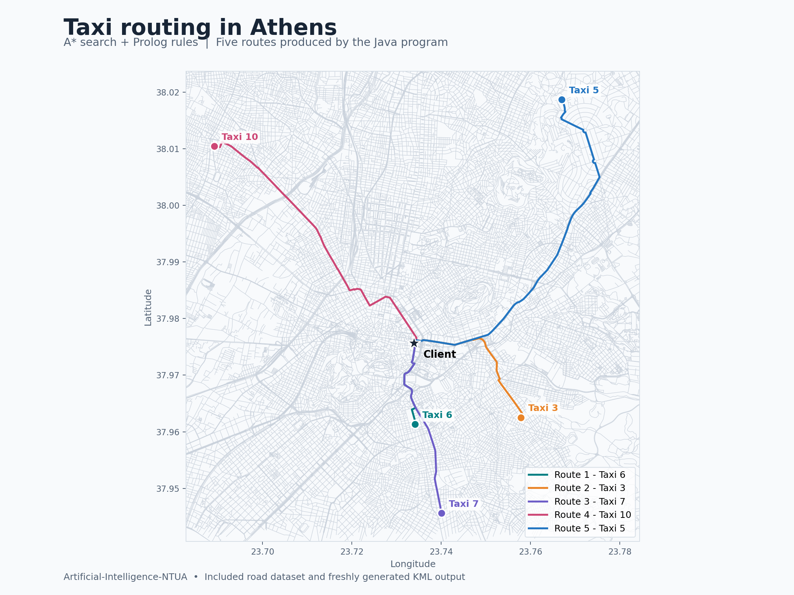

# Taxi routing with A* and Prolog

A Java/Prolog coursework project for the NTUA Artificial Intelligence course. It computes candidate routes from taxis to a client using A* search, with Prolog rules contributing road and taxi reasoning.

## Example output

Visualization of five routes from a successful run with the included dataset. The colored paths come from the program's generated `kml-file.kml`; the background roads come from `nodes.csv`. The star marks the client, and the circles mark the taxis. This is a visualization of the output, not a graphical interface built into the application.

## Code guide

- `src/Main.java`: input parsing, Prolog setup and search workflow.
- `src/Node.java`, `src/Line.java`, `src/Pair.java`: graph and supporting data structures.
- `rules.pl`: Prolog rules.
- `facts1.pl` through `facts4.pl`: generated fact files.
- `src/sort_taxis.pl`: taxi-ordering logic.
- `jipconsole.jar`: bundled Java/Prolog integration dependency.

## Build and run context

Use a Java development environment with the JIProlog classes available on its classpath. Import the Java sources, configure the provided integration JAR and select `Main` as the entry point.

`Main` expects the included `nodes.csv`, `taxis.csv`, `client.csv`, `lines.csv` and `traffic.csv` in the working directory. Run with the repository root as that directory. Fact-file generation rewrites `facts1.pl` through `facts4.pl`, so preserve any manual edits to those files before running it.

## Scope

The project illustrates heuristic graph search combined with declarative rules. It has no packaged build system, automated test suite or reproduced runtime benchmark. Input formats and rule assumptions are tied to the original assignment. Preserve existing collaborator and course attribution when discussing the work.
